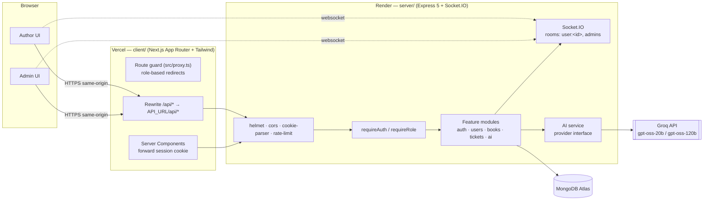
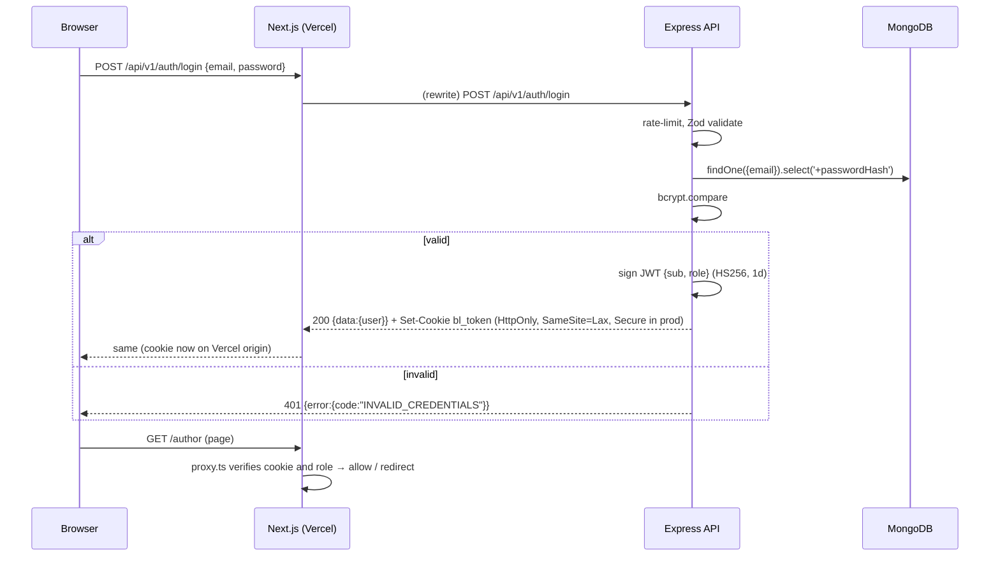
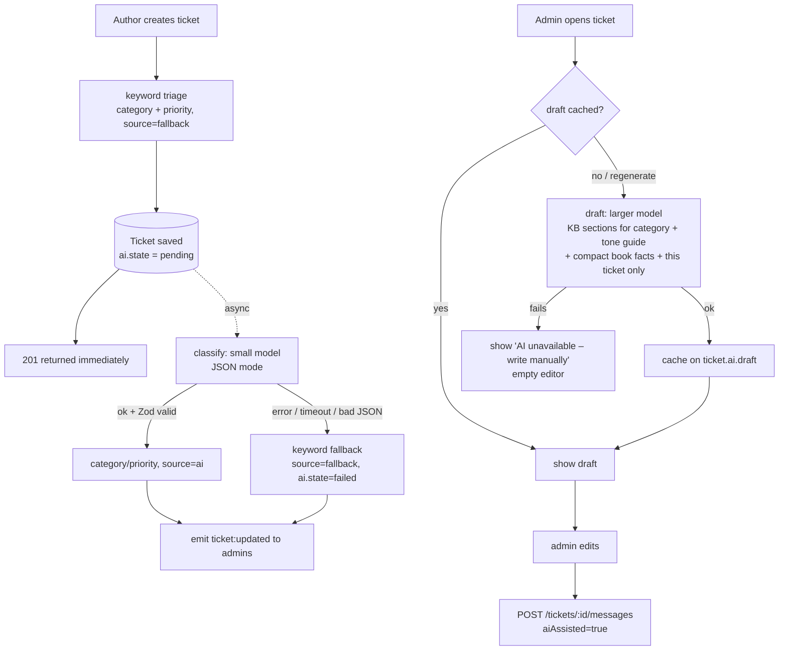

# 02 — Architecture

## 1. System overview



| Layer | Tech | Why |
|---|---|---|
| Frontend | Next.js (App Router) + Tailwind CSS | Server components for fast data pages. File-based routing keeps the author and admin areas apart. Tailwind gives a clean UI quickly. |
| Backend | Node.js + Express 5 (TypeScript) | Express 5 forwards rejected async handlers to the error middleware without extra wrappers. It's a long-running process, so Socket.IO works (Vercel serverless can't hold sockets). |
| Database | MongoDB Atlas + Mongoose 8 | The data is document-shaped (an author with nested book stats, a ticket with AI metadata). Mongoose gives schemas, validation and indexes. |
| Auth | JWT in an httpOnly cookie | Stateless, and XSS-safe because JS never reads the token. |
| Validation | Zod (in `@bookleaf/shared`) | One schema validates the request on the server and the form on the client, and also gives TS types. |
| AI | Groq (`gpt-oss-20b` to classify, `gpt-oss-120b` to draft) behind a provider interface | Free tier, very low latency, OpenAI-compatible JSON mode. Can be swapped for OpenAI or Anthropic by adding one provider file (see §4.2). |
| Real-time | Socket.IO | Rooms per user and an `admins` room. Falls back to long-polling. |

---

## 2. Monorepo layout

```
bookleaf/
├─ packages/shared/     @bookleaf/shared — enums + Zod request schemas (built to CJS)
├─ server/              Express API
│  └─ src/
│     ├─ app.ts         builds the Express app (no listen → testable with Supertest)
│     ├─ server.ts      connects DB, creates the HTTP server, listens
│     ├─ config/        env.ts (Zod-validated env), db.ts
│     ├─ routes.ts      mounts module routers under /api/v1
│     ├─ lib/           app-error, jwt, password, cookies, access (scopeByOwner)
│     ├─ middleware/    auth, validate, error-handler (+ notFound), rate-limit
│     ├─ modules/<feature>/
│     │    <feature>.model.ts       Mongoose schema
│     │    <feature>.dto.ts         whitelisting serializers (what leaves the API)
│     │    <feature>.service.ts     business logic + RBAC scoping
│     │    <feature>.controller.ts  HTTP in/out only
│     │    <feature>.routes.ts      paths + middleware chain
│     ├─ seed/          sample data, Zod raw schema, mappers, seed lib + CLI
│     └─ types/         Express Request augmentation
│  └─ tests/            Jest + Supertest + mongodb-memory-server
└─ client/              Next.js app
   └─ src/
      ├─ proxy.ts       route guard (Next 16 "proxy", formerly middleware)
      ├─ lib/           api.ts (browser fetch), server-api.ts (RSC fetch), session.ts (jose verify), routes.ts
      ├─ components/    portal-shell, live-updates (socket + polling), ticket-thread, badges, ui
      └─ app/           /login, /author/*, /admin/*
```

### Request lifecycle (server)

```
request → helmet/cors/json/cookie-parser
        → router (/api/v1/...)
        → [rateLimit] → [requireAuth] → [requireRole] → validate(zodSchema)
        → controller (reads req, calls service, sends { data })
        → service (scopes queries by user, throws AppError)
        → model (Mongoose)
errors  → errorHandler → { error: { code, message, details? } } with the right status
```

Rules:
- **Controllers** don't touch Mongoose directly and contain no business rules.
- **Services** take the authenticated user as an argument and apply ownership scoping themselves. That way a new route can't forget the RBAC check.
- **Errors** are thrown through the `Errors.*` factories in `lib/app-error.ts` (`validation`, `unauthenticated`, `forbidden`, `notFound`, `ticketClosed`, `aiUnavailable`, …). Everything else becomes a generic 500 and is logged server-side.

---

## 3. Authentication & authorization

### 3.1 Why the API is proxied through Next.js

The browser talks **only to the Vercel origin**. `client/next.config.ts` rewrites `/api/:path*` to `${API_URL}/api/:path*` (Render). As a result:

- The session cookie is **first-party** for the Vercel domain. `SameSite=Lax` works, and there's no third-party-cookie blocking (Safari ITP, Chrome's phase-out).
- No CORS preflights for the browser's API calls.
- `API_URL` is a **server-only** env var, so the backend URL isn't baked into the bundle.
- Next's route guard (`src/proxy.ts`) can read the same cookie and redirect by role before rendering.

The trade-off is one extra network hop (Vercel edge → Render). That's acceptable for a support tool.

### 3.2 Login sequence



### 3.3 Authorization model

| Layer | Mechanism | Purpose |
|---|---|---|
| UI route guard | `src/proxy.ts` verifies the JWT with `jose` and redirects `/author/*` ↔ `/admin/*` by role | UX only. Never trusted for data. |
| `requireAuth` | Reads `bl_token`, verifies it, **re-loads the user from the DB** and sets `req.user = {id, role, name, email}` | A deleted user's token stops working immediately. |
| `requireRole('admin')` | 403 `FORBIDDEN` if the role doesn't match | Admin-only endpoints. |
| Service scoping | `scopeByOwner(user)` → `{author: user.id}` for authors, `{}` for admins | Authors only ever query their own documents. |
| 404 over 403 | Another author's book or ticket → `404 NOT_FOUND` | Doesn't reveal that the resource exists. |
| Separate collections | Internal notes live in their own collection | An author-facing query can't leak notes by forgetting a filter. |

### 3.4 Real-time and socket authentication

Vercel rewrites don't proxy WebSockets, so the browser connects directly to the API origin, where it doesn't have the cookie.
1. The client calls `GET /api/v1/auth/socket-token` (proxied, cookie-authenticated). The API returns a **60-second** JWT with `aud: "bookleaf-socket"`, plus the `url` to connect to (`SOCKET_PUBLIC_URL`). Because the server hands over the URL, the client needs no `NEXT_PUBLIC_` variable. The different audience means a socket token can't be replayed as a session and vice versa.
2. The client calls `io(url, { auth: { token } })`. The `auth` callback fetches a fresh token on every reconnect. The server verifies it in `io.use()`, checks the user still exists, and joins `user:<id>`, plus `admins` for admins.
3. Services emit `ticket:updated` / `ticket:message` (`server/src/realtime/realtime.ts`) to `user:<authorId>` and `admins`. Internal notes go to `admins` only.

**Events are invalidation-only.** The payload is `{ ticketId, ticketNumber }`. On an event, `<LiveUpdates>` (`client/src/components/live-updates.tsx`) calls a debounced `router.refresh()`, so server components re-fetch through the normal REST endpoints. RBAC and DTO whitelisting therefore live in exactly one place, and admin-only data can never leak over the socket. `router.refresh()` keeps client state, so a half-written reply survives a live update.

**Fallback (RT-3).** While the socket is disconnected or can't connect, the hook polls with `router.refresh()` every 15 s when the tab is visible. After a reconnect it refreshes once to catch up on missed events. One connection is shared per tab, and it is closed on logout.

---

## 4. AI pipeline



Cost and robustness decisions:
- **Two model tiers.** Classification uses a small, fast model (`GROQ_MODEL_CLASSIFY`). Drafting uses a larger model (`GROQ_MODEL_DRAFT`).
- **KB sectioning.** The knowledge base is stored as named sections (royalty, isbn, printing, distribution, production, general, tone). A draft prompt includes only the section(s) for the ticket's category, the tone guide, and the one matching sample Q→A. That's about 600–900 tokens, not the full KB.
- **Context minimisation.** Only the selected book's relevant fields are sent (e.g. royalty fields for a royalty ticket, stage for a production ticket), plus this ticket's text and the last N messages (capped). We don't send all of the author's history.
- **Caching.** The draft is stored on the ticket and regenerated only when the admin clicks "Regenerate" or a new author message arrives.
- **Timeouts and retries.** 15 s timeout per attempt, one retry with backoff on 429/5xx, then fall back.
- **Validation.** Every LLM response is parsed with Zod. Anything unparseable is treated as a failure.
- **Never auto-send.** The draft is only a suggestion. Sending is an explicit admin action.

### 4.1 As built (`server/src/modules/ai/`)

| File | Role |
|---|---|
| `ai.provider.ts` | `AiProvider` interface (`completeJson(req, zodSchema)`, `completeText(req)`) and `AiError` kinds: `disabled`, `timeout`, `rate_limited`, `upstream`, `invalid_output` |
| `groq.provider.ts` | `groq-sdk` with a 15 s timeout and `maxRetries: 1` (SDK backoff on 429/5xx). JSON mode, Zod-validated, with **one repair turn** that shows the model its invalid output. Logs `prompt_tokens`/`completion_tokens` per call, never prompt text or the key |
| `provider-registry.ts` | No `GROQ_API_KEY` means `disabled`, and the app still boots. Tests install a fake |
| `knowledge-base.ts` | The KB, verbatim, as sections + sample Q→A per category + `CATEGORY_SECTIONS` |
| `classify.ts` | Rubric prompt, temperature 0, 200 max tokens. Accepts labels as well as ids. **Policy floor:** ISBN tickets are always at least High |
| `draft.ts` | Pure `buildDraftPrompt` (unit-tested): system prompt with the tone guide and hard rules; user prompt with `<kb>`, `<facts>` and `<ticket>` blocks. Temperature 0.4, 800 max tokens |
| `prompt-utils.ts` | Neutralises `<ticket>`/`<kb>`/`<facts>` tags inside author text (prompt-injection guard) and truncates |

The persistence around it is in `modules/tickets/ticket-ai.service.ts`:
- **Classification is applied with conditional writes** (`categorySource != 'admin'`), so an admin override made while the model is thinking always wins.
- **Drafts are cached** on `ticket.ai.draft` and written only if `lastActivityAt` hasn't changed since generation began. Concurrent misses share one in-flight call.
- **Background jobs** run through `lib/background.ts`: ticket creation never awaits them, and failures are logged rather than thrown.

**Deterministic facts, not model arithmetic.** The draft fact sheet carries:
- the next payout window from `nextPayoutWindow()` (quarter end + 45 days)
- whether the pending amount is below the ₹1,000 threshold
- whether BookLeaf is **behind** on a payout (`payoutStatus()`: pending is payable but nothing has been paid since before the last closed window). This is the KB's "genuinely overdue → escalate with 48 h" case.

The model quotes these dates; it doesn't calculate them. Fact labels are written so they can't be misread: the paid amount is stated as a cumulative total, and for production tickets the facts say that no delay reason is recorded, so the model doesn't make one up.

### 4.2 Model choice

| Task | Model | Why |
|---|---|---|
| Classification | `openai/gpt-oss-20b` | A closed-set label task with a tight rubric and JSON mode: the small model is accurate enough. It's the cheapest, lowest-latency chat model on Groq, and it runs on every ticket. Mistakes are bounded: Zod validation, the policy floor and admin overrides catch them, and the keyword triage is already in place |
| Drafting | `openai/gpt-oss-120b` | Tone carries most of the weight here (empathetic, specific, owning mistakes, no fluff), and so does sticking to the facts given. The larger model follows the hard rules and the tone guide more reliably. Drafts are generated only when an admin opens a ticket that needs a reply, and are cached, so the larger model's cost stays proportional to replies, not page views |

The design originally targeted `llama-3.1-8b-instant` / `llama-3.3-70b-versatile`. Groq has since retired them (requests return 404), so these are the current small/large equivalents.

**Reasoning effort.** Both gpt-oss models are reasoning models, and hidden reasoning tokens count against `max_completion_tokens`. At the default effort, gpt-oss-20b used up the classification budget and Groq rejected the truncated JSON (`json_validate_failed`). `groq.provider.ts` therefore sends `reasoning_effort: "low"` for gpt-oss (and `"none"` for Qwen 3). Caps leave headroom for that: 200 tokens for classification, 800 for drafts.

**Measured on the seed data** (7 test tickets, one per category plus a prompt-injection attempt):

| | Classification | Draft |
|---|---|---|
| Prompt tokens | ~530–650 | ~770–930 |
| Completion tokens (of which reasoning) | ~40–57 (5–16) | ~190–270 (24–80) |
| Latency | 0.2–0.7 s | 0.7–1.1 s |
| Result | 7/7 correct, injection classified as general/low | grounded figures and KB timelines; overdue royalty escalated |

Groq was chosen for its latency, which keeps the draft quick to appear when an admin opens a ticket, and for its free tier, which fits the brief. Both models can be swapped through env vars without code changes, and the `AiProvider` seam keeps the vendor replaceable.

---

## 5. Data model

See [`03-data-model.md`](03-data-model.md).

## 6. Deployment

Live: web https://book-publishing-portal.vercel.app · API https://book-publishing-portal.onrender.com (health: `/api/v1/health`).

| Piece | Host | Notes |
|---|---|---|
| `client/` | Vercel | Root directory `client`. Vercel installs from the repo root (npm workspaces), so the root `postinstall` builds `@bookleaf/shared`. Env: `API_URL` (Render URL), `JWT_SECRET` (for the route guard's verify), `NEXT_PUBLIC_SHOW_DEMO_LOGINS=true`. The socket URL comes from `GET /auth/socket-token`, so the API URL is never public config. |
| `server/` | Render web service, from [`render.yaml`](../render.yaml) | Build: `npm ci --include=dev && npm run build -w server` (`--include=dev` because `NODE_ENV=production` would skip TypeScript). Start: `npm start -w server`. Health check: `/api/v1/health` (503 when MongoDB is down). |
| Database | MongoDB Atlas (M0) | Network access `0.0.0.0/0` (Render has no static egress IPs on the free plan). Seeded from a dev machine with `npm run seed -- --reset`. |

### Environment

| Variable | Render (API) | Vercel (client) |
|---|---|---|
| `NODE_ENV` | `production` | (set by Vercel) |
| `MONGODB_URI` | Atlas SRV URI | — |
| `JWT_SECRET` | 32+ random chars | **the same value** |
| `GROQ_API_KEY` | Groq key (optional: without it the app runs on keyword triage + manual replies) | — |
| `CLIENT_ORIGIN` | Vercel URL | — |
| `SOCKET_PUBLIC_URL` | Render URL | — |
| `TRUST_PROXY` | `2` (Vercel rewrite + Render proxy) | — |
| `LOGIN_RATE_LIMIT_MAX` | `30` | — |
| `API_URL` | — | Render URL |
| `NEXT_PUBLIC_SHOW_DEMO_LOGINS` | — | `true` (only toggles the demo buttons; not a secret) |

`JWT_SECRET` is shared by the API and the Next server runtime. It's never prefixed `NEXT_PUBLIC_`, so it doesn't reach the browser.

### Order of operations

Each host needs the previous one's URL:

1. **Atlas:** create the cluster and a database user, allow `0.0.0.0/0`.
2. **Seed:** point `server/.env` at the Atlas URI and run `npm run seed -- --reset`.
3. **Render:** New → Blueprint → this repo. Fill in the secrets; use a placeholder for `CLIENT_ORIGIN`. Set `SOCKET_PUBLIC_URL` to the service URL Render assigns.
4. **Vercel:** import the repo with root directory `client` and set its env.
5. **Render:** set `CLIENT_ORIGIN` to the Vercel URL and redeploy.

The free Render plan sleeps after 15 minutes idle and takes about 50 s to wake. Open `/api/v1/health` once before a demo.
