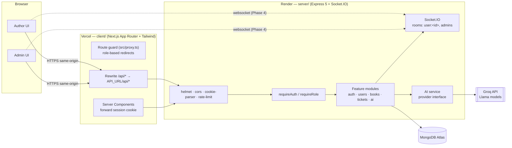
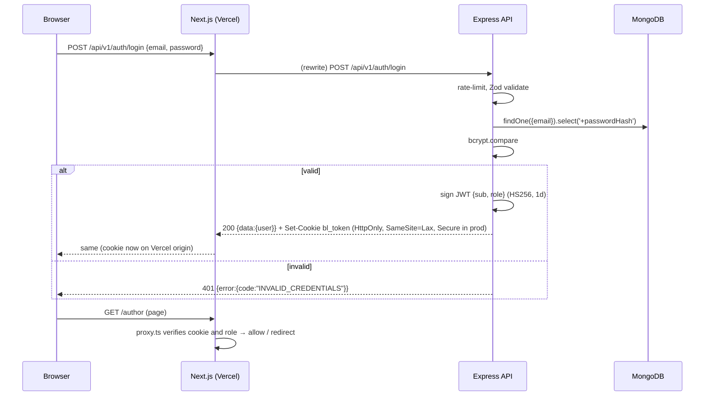
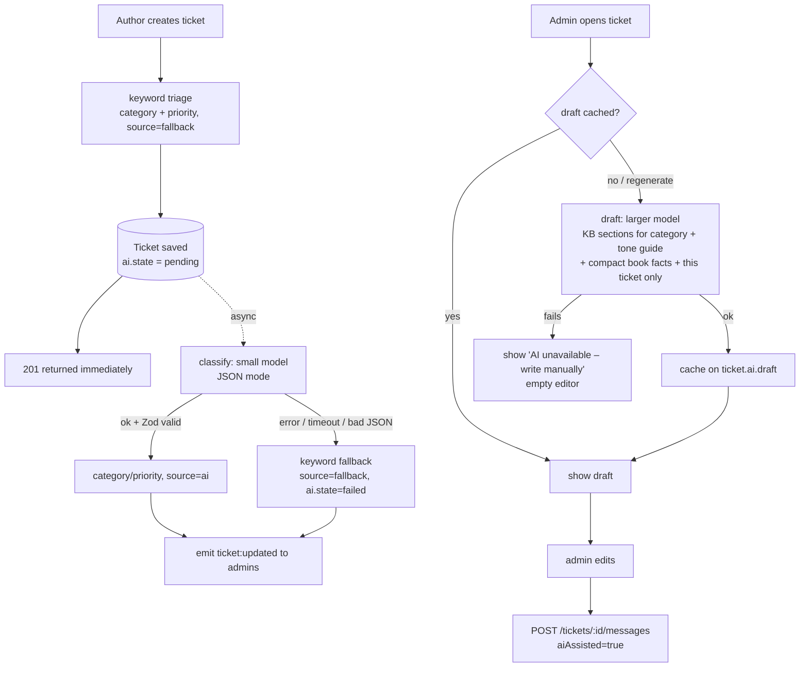

# 02 — Architecture

## 1. System overview



| Layer | Tech | Why |
|---|---|---|
| Frontend | Next.js (App Router) + Tailwind CSS | Server components for fast data pages. File-based routing keeps the author and admin areas apart. Tailwind gives a clean UI quickly. |
| Backend | Node.js + Express 5 (TypeScript) | Express 5 forwards rejected async handlers to the error middleware without extra wrappers. It's a long-running process, so Socket.IO works (Vercel serverless can't hold sockets). |
| Database | MongoDB Atlas + Mongoose 8 | The data is document-shaped (an author with nested book stats, a ticket with AI metadata). Mongoose gives schemas, validation and indexes. |
| Auth | JWT in an httpOnly cookie | Stateless, and XSS-safe because JS never reads the token. |
| Validation | Zod (in `@bookleaf/shared`) | One schema validates the request on the server and the form on the client, and also gives TS types. |
| AI | Groq (Llama 3.x) behind a provider interface | Free tier, very low latency, OpenAI-compatible JSON mode. Can be swapped for OpenAI or Anthropic by adding one provider file. |
| Real-time | Socket.IO | Rooms per user and an `admins` room. Falls back to long-polling. |

---

## 2. Monorepo layout

```
bookleaf/
├─ packages/shared/     @bookleaf/shared — enums + Zod request schemas (built to CJS)
├─ server/              Express API
│  └─ src/
│     ├─ app.ts         builds the Express app (no listen → testable with Supertest)
│     ├─ server.ts      connects DB, creates the HTTP server, listens
│     ├─ config/        env.ts (Zod-validated env), db.ts
│     ├─ routes.ts      mounts module routers under /api/v1
│     ├─ lib/           app-error, jwt, password, cookies, access (scopeByOwner)
│     ├─ middleware/    auth, validate, error-handler (+ notFound), rate-limit
│     ├─ modules/<feature>/
│     │    <feature>.model.ts       Mongoose schema
│     │    <feature>.dto.ts         whitelisting serializers (what leaves the API)
│     │    <feature>.service.ts     business logic + RBAC scoping
│     │    <feature>.controller.ts  HTTP in/out only
│     │    <feature>.routes.ts      paths + middleware chain
│     ├─ seed/          sample data, Zod raw schema, mappers, seed lib + CLI
│     └─ types/         Express Request augmentation
│  └─ tests/            Jest + Supertest + mongodb-memory-server
└─ client/              Next.js app
   └─ src/
      ├─ proxy.ts       route guard (Next 16 "proxy", formerly middleware)
      ├─ lib/           api.ts (browser fetch), server-api.ts (RSC fetch), session.ts (jose verify), routes.ts
      ├─ components/    portal-shell (header + user menu), logout-button
      └─ app/           /login, /author/*, /admin/*
```

### Request lifecycle (server)

```
request → helmet/cors/json/cookie-parser
        → router (/api/v1/...)
        → [rateLimit] → [requireAuth] → [requireRole] → validate(zodSchema)
        → controller (reads req, calls service, sends { data })
        → service (scopes queries by user, throws AppError)
        → model (Mongoose)
errors  → errorHandler → { error: { code, message, details? } } with the right status
```

Rules:
- **Controllers** don't touch Mongoose directly and contain no business rules.
- **Services** take the authenticated user as an argument and apply ownership scoping themselves. That way a new route can't forget the RBAC check.
- **Errors** are thrown as `AppError` (`badRequest`, `unauthorized`, `forbidden`, `notFound`, `conflict`). Everything else becomes a generic 500 and is logged server-side.

---

## 3. Authentication & authorization

### 3.1 Why the API is proxied through Next.js

The browser talks **only to the Vercel origin**. `client/next.config.ts` rewrites `/api/:path*` to `${API_URL}/api/:path*` (Render). As a result:

- The session cookie is **first-party** for the Vercel domain. `SameSite=Lax` works, and there's no third-party-cookie blocking (Safari ITP, Chrome's phase-out).
- No CORS preflights for the browser's API calls.
- `API_URL` is a **server-only** env var, so the backend URL isn't baked into the bundle.
- Next's route guard (`src/proxy.ts`) can read the same cookie and redirect by role before rendering.

The trade-off is one extra network hop (Vercel edge → Render). That's acceptable for a support tool.

### 3.2 Login sequence



### 3.3 Authorization model

| Layer | Mechanism | Purpose |
|---|---|---|
| UI route guard | `src/proxy.ts` verifies the JWT with `jose` and redirects `/author/*` ↔ `/admin/*` by role | UX only. Never trusted for data. |
| `requireAuth` | Reads `bl_token`, verifies it, **re-loads the user from the DB** and sets `req.user = {id, role, name, email}` | A deleted user's token stops working immediately. |
| `requireRole('admin')` | 403 `FORBIDDEN` if the role doesn't match | Admin-only endpoints. |
| Service scoping | `scopeByOwner(user)` → `{author: user.id}` for authors, `{}` for admins | Authors only ever query their own documents. |
| 404 over 403 | Another author's book or ticket → `404 NOT_FOUND` | Doesn't reveal that the resource exists. |
| Separate collections | Internal notes live in their own collection | An author-facing query can't leak notes by forgetting a filter. |

### 3.4 Socket authentication (Phase 4)

Vercel rewrites don't proxy WebSockets, so the browser connects directly to the Render origin, where it doesn't have the cookie. Plan:
1. The client calls `GET /api/v1/auth/socket-token` (proxied, cookie-authenticated). The API returns a **60-second** JWT with `aud: "socket"`.
2. The client calls `io(SOCKET_URL, { auth: { token } })`. The server verifies it in `io.use()` and joins `user:<id>`, plus `admins` for admins.
3. Services emit `ticket:updated` / `ticket:message` to `user:<authorId>` and `admins`. Internal notes are emitted to `admins` only.

---

## 4. AI pipeline (Phase 3 design)



Cost and robustness decisions:
- **Two model tiers.** Classification uses a small, fast model (`GROQ_MODEL_CLASSIFY`). Drafting uses a larger model (`GROQ_MODEL_DRAFT`).
- **KB sectioning.** The knowledge base is stored as named sections (royalty, isbn, printing, distribution, production, general, tone). A draft prompt includes only the section(s) for the ticket's category, the tone guide, and the one matching sample Q→A. That's about 600–900 tokens, not the full KB.
- **Context minimisation.** Only the selected book's relevant fields are sent (e.g. royalty fields for a royalty ticket, stage for a production ticket), plus this ticket's text and the last N messages (capped). We don't send all of the author's history.
- **Caching.** The draft is stored on the ticket and regenerated only when the admin clicks "Regenerate" or a new author message arrives.
- **Timeouts and retries.** 10–15 s timeout, one retry with backoff on 429/5xx, then fall back.
- **Validation.** Every LLM response is parsed with Zod. Anything unparseable is treated as a failure.
- **Never auto-send.** The draft is only a suggestion. Sending is an explicit admin action.

---

## 5. Data model

See [`03-data-model.md`](03-data-model.md).

## 6. Deployment

| Piece | Host | Notes |
|---|---|---|
| `client/` | Vercel | Env: `API_URL` (Render URL), `JWT_SECRET` (for the route guard's verify), `NEXT_PUBLIC_SOCKET_URL` (Phase 4). |
| `server/` | Render web service | Build: `npm ci && npm run build:shared && npm run build -w server`. Start: `npm start -w server`. Env per `server/.env.example`. |
| Database | MongoDB Atlas (M0) | Seeded once with `npm run seed -- --reset`. |

`JWT_SECRET` is shared by the API and the Next server runtime. It's never prefixed `NEXT_PUBLIC_`, so it doesn't reach the browser.
