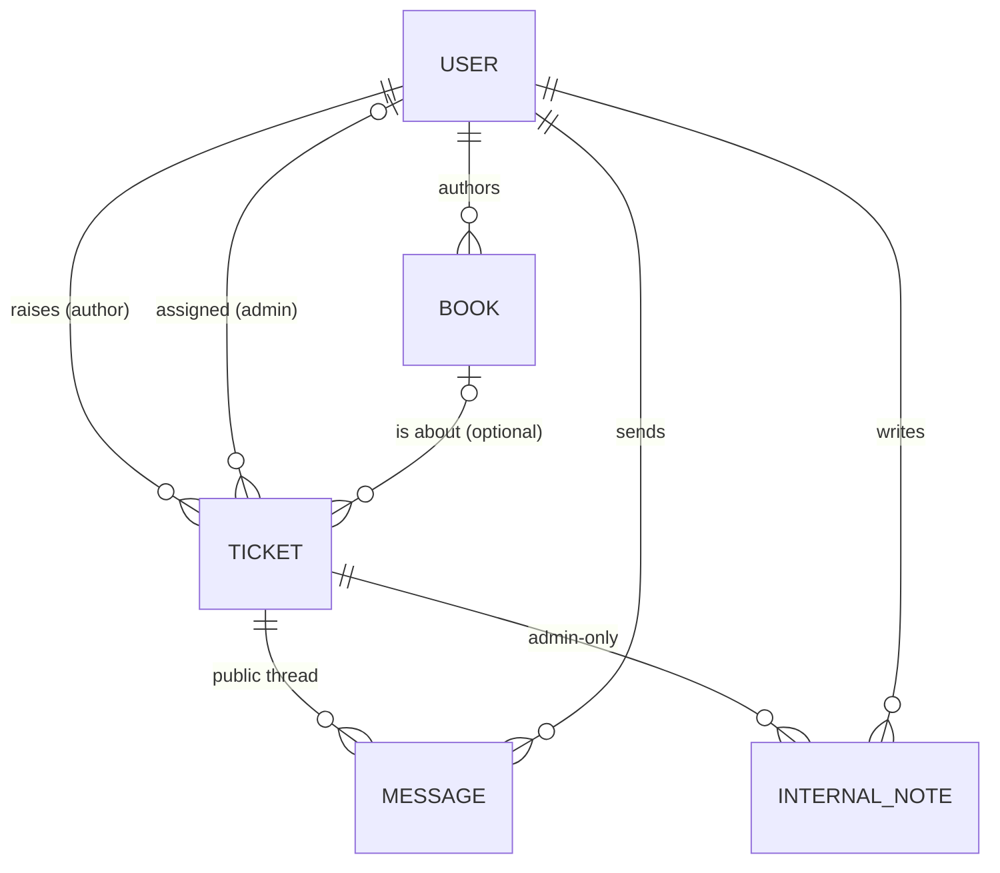

# 03 — Data Model (MongoDB / Mongoose)

Conventions:
- All collections have `createdAt` / `updatedAt` (`timestamps: true`).
- JSON output removes `_id` and `__v` and exposes `id` instead (`toJSON` transform).
- Money is stored as **whole rupees (Number)**, because the dataset only has integers. Production would use paise or `Decimal128`.
- External IDs from the dataset (`AUTH001`, `BK001`) are kept as `externalId`, so the seed is idempotent and ops staff can search by them.

---

## `users`

One collection for both roles. Author-only data lives in `authorProfile`.

| Field | Type | Notes |
|---|---|---|
| `email` | String, **unique**, lowercase, trimmed | Login identifier |
| `passwordHash` | String, `select: false` | bcrypt (cost 10). Never returned by default. |
| `name` | String | |
| `role` | `'author' \| 'admin'` | RBAC |
| `authorProfile` | `{ externalId, phone, city, joinedDate }` \| undefined | Only for authors. `externalId` unique (sparse). |

Indexes: `{ email: 1 }` unique, `{ 'authorProfile.externalId': 1 }` unique sparse, `{ role: 1 }`.

Why one collection: login, `requireAuth` and assignment (`assignee → users`) all look up a single collection. Two roles don't justify discriminators.

## `books`

| Field | Type | Source field |
|---|---|---|
| `externalId` | String, **unique** | `book_id` |
| `author` | ObjectId → users, indexed | parent `author_id` |
| `title` | String | `title` |
| `isbn` | String, unique | `isbn` (placeholder values, no checksum) |
| `genre` | String | `genre` |
| `publicationDate` | Date \| null | `publication_date` |
| `stage` | enum `PRODUCTION_STAGES` | `status` (mapped, see below) |
| `mrp` | Number \| null | `mrp` |
| `royaltyPerCopy` | Number \| null | `author_royalty_per_copy` |
| `copiesSold` | Number ≥ 0 | `total_copies_sold` |
| `royalty.earned` / `.paid` / `.pending` | Number ≥ 0 | `total_royalty_earned` / `royalty_paid` / `royalty_pending` |
| `lastRoyaltyPayoutDate` | Date \| null | `last_royalty_payout_date` |
| `printPartner` | `'In-House' \| 'Repro India' \| 'Epitome Books'` \| null | `print_partner` |
| `availableOn` | [String] | `available_on` |

`stage` enum, in order (from the KB's Production Stages):
`manuscript_received → editing → cover_design → typesetting → proofreading → isbn_assignment → printing → distribution_setup → published_live`.
Storing an enum instead of the raw label lets the UI draw a progress bar and lets the AI reason about "how far along" a book is. The human label is produced by a lookup in `@bookleaf/shared`.

Indexes: `{ externalId: 1 }` unique, `{ author: 1, publicationDate: -1 }`.

## `tickets`

| Field | Type | Notes |
|---|---|---|
| `ticketNumber` | String, unique, e.g. `BL-1001` | From the `counters` collection. Human-friendly in support conversations. |
| `author` | ObjectId → users | Owner. Every author query is scoped by this field. |
| `book` | ObjectId → books \| null | `null` = "General / Account Level". Must belong to `author` (checked in the service). |
| `subject` | String (5–150) | |
| `description` | String (20–5000) | |
| `attachments` | `[{ name, size, mimeType }]` | Metadata only (upload is out of scope) |
| `status` | `open \| in_progress \| resolved \| closed` | Default `open` |
| `isActive` | Boolean | Derived from `status` (open/in_progress) in a `pre('validate')` hook. Stored so the queue can sort "unresolved first" with an index instead of an aggregation. |
| `category` | enum of 6 categories \| null | Set at creation by keyword triage (`fallback`), then refined by the AI or overridden by an admin |
| `categorySource` | `ai \| admin \| fallback` \| null | Audit of who decided |
| `priority` | `critical \| high \| medium \| low` \| null | |
| `priorityRank` | Number 4..1 (0 = unscored) | Sortable copy of `priority` |
| `prioritySource` | `ai \| admin \| fallback` \| null | |
| `ai.state` | `pending \| done \| failed` | Classification pipeline state |
| `ai.classification` | `{ category, priority, reasoning, model, at }` | Raw AI verdict, kept even after an admin overrides it (useful for measuring accuracy) |
| `ai.draft` | `{ body, model, generatedAt }` \| null | Cached draft. **Never sent to authors.** |
| `ai.error` | String \| null | Last AI failure reason (shown to admins) |
| `assignee` | ObjectId → users (admin) \| null | |
| `lastActivityAt` | Date | Bumped on every message or status change. Drives "stale" highlighting (> 48 h while active). |
| `lastReplyRole` | `author \| admin` \| null | Who spoke last in the public thread. Drives "Awaiting our reply" in the queue and "New reply" for authors. |
| `resolvedAt` | Date \| null | Stamped on resolved/closed, cleared on reopen |

Indexes:
- `{ author: 1, createdAt: -1 }`: the author's "My Tickets"
- `{ isActive: -1, priorityRank: -1, createdAt: 1 }`: the admin queue's default sort (unresolved, then urgent, then oldest)
- `{ status: 1, lastActivityAt: 1 }`: status filters and stale detection
- `{ category: 1 }`, `{ assignee: 1 }`: queue filters

Field projection: the author-facing serializer (`toAuthorTicketDto`) whitelists fields (`ticketNumber, book, subject, description, attachments, status, category, lastReplyRole, lastActivityAt, resolvedAt, createdAt, updatedAt`). It never includes `ai`, `priority*`, `*Source`, `assignee` or `isStale`.

Status transitions happen in `ticket.service.ts`:
- An admin reply moves `open` to `in_progress`.
- An author reply moves `resolved` back to `open`.
- `closed` accepts no replies (`409 TICKET_CLOSED`).
- Admins can set any status explicitly.

## `messages` (public thread)

| Field | Type | Notes |
|---|---|---|
| `ticket` | ObjectId → tickets, indexed | |
| `sender` | ObjectId → users | |
| `senderRole` | `author \| admin` | Denormalised for cheap rendering |
| `body` | String (1–10000) | |
| `aiAssisted` | Boolean | True if the admin started from the AI draft. Useful for measuring AI adoption. |

Index: `{ ticket: 1, createdAt: 1 }`.

## `internalnotes` (admin only)

| Field | Type |
|---|---|
| `ticket` | ObjectId → tickets, indexed |
| `admin` | ObjectId → users |
| `body` | String (1–5000) |

**Why a separate collection and not `messages.visibility`:** author-facing endpoints only ever query `messages`, so an internal note can't reach an author through a forgotten `{ visibility: 'public' }` filter. Leaking a note is the costliest privacy bug in this app, so we design it out instead of guarding against it.

## `counters`

`{ _id: 'ticket', seq: Number }`. `findOneAndUpdate({ $inc: { seq: 1 } }, { upsert: true, new: true })` gives an atomic, monotonic ticket number.
