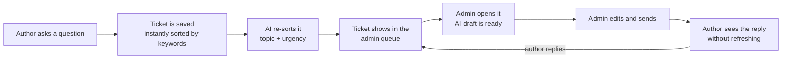

# 07: User guide and manual testing

This guide explains, in simple words, what the BookLeaf Support Portal does, who uses it, and how to test every screen by hand.

---

## 1. What is this app?

BookLeaf publishes books for thousands of authors. Authors often have questions:
- "Where is my royalty?"
- "My ISBN is wrong."
- "My printed copy is damaged."
- "When will my book be ready?"

This app gives them **one place to ask**, and gives the BookLeaf team **one place to answer**. An **AI helper** sorts every question and writes a first draft of the reply. A person from the team always checks that draft before the author sees it.

## 2. Who uses it?

| Who | What they do | Where they go |
|---|---|---|
| **Author** | Sees their books and money, asks questions, reads replies | The **Author portal** (`/author`) |
| **Admin** (BookLeaf support team) | Sees every question from every author, replies, manages tickets | The **Admin portal** (`/admin`) |
| **AI helper** | Works in the background. Sorts each question by topic and urgency, and drafts replies | No screen of its own. Its work shows up inside the Admin portal |

A question is called a **ticket**. Every ticket gets a number like `BL-1011`.

## 3. The big picture: the life of one ticket

In words:
1. An **author** fills in a short form and sends a question.
2. The app saves it **right away** and gives it a first guess at the topic and urgency, using simple keyword rules.
3. A second or two later, the **AI** reads it properly and updates the topic (for example *Royalty & Payments*) and the urgency (*Critical / High / Medium / Low*).
4. The ticket appears in the **admin queue**. The most urgent and oldest tickets are at the top.
5. An **admin** opens the ticket. The AI has already written a **draft reply** using BookLeaf's policies and the author's real book and royalty numbers.
6. The admin **reads, edits and sends** the reply. Nothing is ever sent by the AI on its own.
7. The **author** sees the reply on their screen straight away, without pressing refresh.
8. If the author writes back, the ticket goes back to the team, and the loop continues until the ticket is **Resolved** or **Closed**.

### Ticket statuses

| Status | Meaning | How it gets there |
|---|---|---|
| **Open** | New. Nobody has replied yet | The author raises a ticket |
| **In Progress** | The team is working on it | Automatically when an admin sends the first reply, or set by hand |
| **Resolved** | The team thinks it's fixed | Set by an admin. **If the author replies, it goes back to Open** |
| **Closed** | Finished for good | Set by an admin. Nobody can reply; the author must raise a new ticket |

### Topics (categories) and urgency (priority)

- **Topics:** Royalty & Payments · ISBN & Metadata Issues · Printing & Quality · Distribution & Availability · Book Status & Production Updates · General Inquiry
- **Urgency:** Critical → High → Medium → Low. Example: *"No royalty for 6 months"* is Critical; *"Can I change my bio?"* is Low. An ISBN mistake is always at least High, because that is BookLeaf's policy.

---

## 4. Logging in

Go to **`/login`**. At the top there is a switch with two tabs:

| Tab | For | Look | Direct link |
|---|---|---|---|
| **Author** (default) | Authors | Warm green, "Your book's journey" | `/login` |
| **BookLeaf Team** | Support staff (admins) | Dark console, "The support console" | `/login?as=team` |

Pick your tab, then type an email and password, or click one of the demo accounts listed under the form. Each tab shows its own demo accounts.

Both tabs use the **same login system**. The tab only makes sure you are signing in to the right place. If you use the wrong tab (for example an admin on the Author tab), you see *"This is a BookLeaf team account. Switch to the BookLeaf Team sign-in."* and a **Switch** button. Your email and password stay filled in. A wrong password always shows the same *"Invalid email or password"* message on both tabs.

| Role | Email | Password |
|---|---|---|
| Admin | `admin@bookleaf.com` | `Admin@123` |
| Admin | `support@bookleaf.com` | `Admin@123` |
| Author | `priya.sharma@email.com` | `Author@123` |
| Author | `sneha.kulkarni@email.com` | `Author@123` |
| Author | `kavita.deshmukh@email.com` | `Author@123` |
| Author | `ananya.reddy@email.com` | `Author@123` |
| Author | `diya.chatterjee@email.com` | `Author@123` |

Every author in the sample data uses their own email and `Author@123`.

After login:
- **Authors** land on `/author`.
- **Admins** land on `/admin`.
- If you try to open the other portal, you are sent back to your own.
- If you are not logged in, an author page sends you to `/login`, and an admin page sends you to `/login?as=team`.
- Use the menu at the top right to **log out**. You return to the tab you signed in from.

---

## 5. Author journey

### 5.1 Dashboard: `/author`
Your home page. It shows:
- How many books you have, copies sold, royalty earned and **pending payout**.
- A short note that explains your money in plain words. For example: *"₹850 is below the ₹1,000 minimum payout, so it rolls over to the next quarter"*, or *"You're all caught up"*.
- Your open support requests.
- Buttons to **raise a new ticket** or **view your books**.

### 5.2 My Books: `/author/books`
One card per book, with title, ISBN, genre, publication date, status, MRP, copies sold, royalty earned / paid / pending, and where it's sold.
- **Books still being made** show which step they are at (for example *Cover Design, step 3 of 9*) and "—" instead of ₹0 for price and sales.
- Each book has a small payout label: *All paid*, *Payout pending*, *No payout yet* or *Not yet on sale*.
- Each book has a **"Get help with this book"** link that opens the ticket form with that book already chosen.

### 5.3 Raise a ticket: `/author/tickets/new`
Fill in:
1. **Which book?** Pick one of your books, or **"General / Account Level"** if it isn't about one book.
2. **Subject:** a short title (at least 5 characters).
3. **Description:** explain the problem (at least 20 characters).
4. **Attachments** (optional): up to 5 files of 10 MB or less each. *Only the file names are saved; files are not uploaded yet.*

Press **Submit ticket**. You go straight to your new ticket.

### 5.4 My Tickets: `/author/tickets`
A list of every ticket you raised, with its status. Tabs at the top filter by status (`?status=open`, `in_progress`, `resolved`, `closed`). Tickets where the team has replied are marked so you notice them.

### 5.5 One ticket: `/author/tickets/<id>`
- **At the top:** a coloured box that explains the status in plain words, for example *"Our team is working on this. We'll update you here."*
- **In the middle:** your original question and every reply from the BookLeaf team, oldest first.
- **At the bottom:** a box to reply.
  - Replying to a **Resolved** ticket reopens it.
  - **Closed** tickets can't be replied to.
- The page **updates by itself** when the team replies or changes the status.

Authors **never** see internal notes, AI drafts, the urgency score, or who is assigned.

---

## 6. Admin journey

### 6.1 Dashboard: `/admin`
What needs attention right now:
- **Counters:** *Open*, *In progress*, *Unassigned*, *Stale* (no activity for 48 hours or more), *Assigned to me*. Click any counter to open the queue already filtered.
- **Urgency bar:** how many active tickets are Critical / High / Medium / Low. Click a section to filter by it.
- **Needs attention:** the top tickets to work on next.

### 6.2 Ticket Queue: `/admin/tickets`
Every ticket from every author.
- **Default view:** active tickets (Open + In Progress), **most urgent first, then oldest**.
- **Filters:** Status, Category, Priority, Assignee (anyone / me / unassigned), date range (from / to), Sort, and a search box. Search matches the subject, the description or a ticket number such as `BL-1002`.
- **Badges** show the age, a **Stale** flag, and whether the author is waiting for a reply.
- Filters are saved in the address bar, so you can bookmark or share a filtered view.

### 6.3 Ticket workspace: `/admin/tickets/<id>`
This is where the work happens.

**Left side: the conversation and the reply box**
- **Thread:** the author's question and every reply.
- **Reply box:**
  - If the author is waiting for an answer, the **AI draft** loads into the box automatically. A label shows it came from the AI.
  - You can **edit it freely**, click **Regenerate** for a new draft, or **Discard** it and write your own.
  - If the AI is down, you see *"AI draft unavailable"* and an empty box. Write the reply yourself, or press **Try again**.
  - Before sending, choose what happens next: *keep status* (an Open ticket moves to In Progress), *mark Resolved* or *mark Closed*.
  - Press **Send reply**. The author sees it immediately.

**Right side: panels**

| Panel | What it does |
|---|---|
| **Ticket** | Change **Status**, **Category** and **Priority**. Each saves at once. A small badge shows where the current value came from: **AI**, **Admin** (you changed it) or **Fallback** (keyword rules). **Assignee**: pick any teammate from the dropdown, or click **Assign to me** / **Take over**. |
| **AI triage** | What the AI decided, and a one-line reason why. If the AI failed, it says so and offers **Re-run AI triage**. |
| **Author** | The author's details and **all their books** with sales, paid, pending and last payout. The book this ticket is about is highlighted. There's a link to see all of this author's tickets. |
| **Internal notes** | Notes for the team only (*Team only* label). **Authors never see these.** |

When you change the category or priority by hand, the AI will **never overwrite it**, even if it finishes later.

### 6.4 Authors: `/admin/authors`
Every author with their number of books (live / in production), copies sold and royalty totals. Each row links to that author's tickets.

---

## 7. What if the AI is down?

Nothing breaks:
- Authors can still raise tickets. Each ticket is sorted by keyword rules and marked **Fallback**.
- Admins see *"AI classification failed… Triage came from keyword rules"* and can press **Re-run AI triage** later.
- The reply box shows *"AI draft unavailable"*, and the admin writes the reply by hand.

To try this locally, remove `GROQ_API_KEY` from `server/.env` and restart the API.

---

## 8. All URLs for manual testing

### 8.1 Base addresses

| What | Local | Live |
|---|---|---|
| Web app (both portals) | http://localhost:3000 | https://book-publishing-portal.vercel.app |
| REST API | http://localhost:4000/api/v1 | https://book-publishing-portal.onrender.com/api/v1 |
| API health check | http://localhost:4000/api/v1/health | https://book-publishing-portal.onrender.com/api/v1/health |

In the browser, the app calls the API through its own address (`http://localhost:3000/api/v1/...`, or `https://book-publishing-portal.vercel.app/api/v1/...` live), so you can open those URLs too once you're logged in. The page URLs below use `localhost:3000`; on the live site, swap in `https://book-publishing-portal.vercel.app`.

### 8.2 Web pages

| Page | URL | Who can open it |
|---|---|---|
| Home (redirects) | http://localhost:3000/ | Anyone. Sends you to login or your portal |
| Login (Author tab) | http://localhost:3000/login | Anyone |
| Login (BookLeaf Team tab) | http://localhost:3000/login?as=team | Anyone |
| **Author** dashboard | http://localhost:3000/author | Authors |
| My Books | http://localhost:3000/author/books | Authors |
| My Tickets | http://localhost:3000/author/tickets | Authors |
| My Tickets, by status | http://localhost:3000/author/tickets?status=open (also `in_progress`, `resolved`, `closed`) | Authors |
| Raise a ticket | http://localhost:3000/author/tickets/new | Authors |
| Raise a ticket for one book | http://localhost:3000/author/tickets/new?bookId=`<book id>` (use the link on My Books) | Authors (own books only) |
| One ticket (author view) | http://localhost:3000/author/tickets/`<ticket id>` (open it from My Tickets) | The author who owns it |
| **Admin** dashboard | http://localhost:3000/admin | Admins |
| Ticket queue | http://localhost:3000/admin/tickets | Admins |
| One ticket (workspace) | http://localhost:3000/admin/tickets/`<ticket id>` (open it from the queue) | Admins |
| Authors directory | http://localhost:3000/admin/authors | Admins |

Ticket and book ids are long database ids, so open them by clicking rather than typing.

### 8.3 Handy queue links (admin)

| View | URL |
|---|---|
| Open only | http://localhost:3000/admin/tickets?status=open |
| All statuses | http://localhost:3000/admin/tickets?status=all |
| Unassigned active tickets | http://localhost:3000/admin/tickets?status=open,in_progress&assignee=unassigned |
| My tickets | http://localhost:3000/admin/tickets?status=open,in_progress&assignee=me |
| Critical only | http://localhost:3000/admin/tickets?status=open,in_progress&priority=critical |
| Royalty tickets | http://localhost:3000/admin/tickets?category=royalty_payments |
| ISBN tickets | http://localhost:3000/admin/tickets?category=isbn_metadata |
| Longest without activity | http://localhost:3000/admin/tickets?status=open,in_progress&sort=idle |
| Oldest first | http://localhost:3000/admin/tickets?sort=oldest |
| Search a ticket number | http://localhost:3000/admin/tickets?q=BL-1002 |
| Created in a date range | http://localhost:3000/admin/tickets?from=2026-10-01&to=2026-10-31 |

Category values: `royalty_payments`, `isbn_metadata`, `printing_quality`, `distribution_availability`, `book_status_production`, `general_inquiry`. Priority values: `critical`, `high`, `medium`, `low`.

### 8.4 API endpoints (for Postman or curl)

Log in first: `POST /api/v1/auth/login` with `{ "email": "...", "password": "..." }`. Keep the `bl_token` cookie for the other calls. Full details are in [`04-api.md`](04-api.md).

| Method | URL | Who |
|---|---|---|
| GET | /api/v1/health | anyone |
| POST | /api/v1/auth/login | anyone |
| POST | /api/v1/auth/logout | anyone |
| GET | /api/v1/auth/me | logged in |
| GET | /api/v1/auth/socket-token | logged in |
| GET | /api/v1/books | author (own) / admin (all, `?authorId=`) |
| GET | /api/v1/books/BK001 | author (own) / admin (any) |
| GET | /api/v1/authors | admin |
| GET | /api/v1/admins | admin |
| GET | /api/v1/tickets | author (own) / admin (all, with filters) |
| POST | /api/v1/tickets | author |
| GET | /api/v1/tickets/stats | admin |
| GET | /api/v1/tickets/:id | owner author / admin |
| PATCH | /api/v1/tickets/:id | admin (status, category, priority, assigneeId) |
| POST | /api/v1/tickets/:id/messages | owner author / admin |
| POST | /api/v1/tickets/:id/notes | admin |
| GET | /api/v1/tickets/:id/ai-draft | admin (cached draft) |
| POST | /api/v1/tickets/:id/ai-draft | admin (new draft) |
| POST | /api/v1/tickets/:id/classify | admin (re-run AI triage) |

---

## 9. Manual test checklist

Use **two browser windows**, for example a normal window and a private window, so you can be an author and an admin at the same time.

### Login and access
| # | Do this | You should see |
|---|---|---|
| 1 | Open `/admin` while logged out | You are sent to `/login?as=team` (BookLeaf Team tab, dark theme) |
| 2 | Log in with a wrong password | "Invalid email or password". Same message for an unknown email |
| 3 | Log in as Priya, then open `/admin` | You are sent back to `/author` |
| 4 | Log in as admin, then open `/author` | You are sent back to `/admin` |
| 5 | Log out | You land on the tab you signed in from; the back button doesn't show portal data |
| 5a | On the **Author** tab, sign in as `admin@bookleaf.com` | *"This is a BookLeaf team account…"* with a **Switch** button; no login happens |
| 5b | Click **Switch**, then **Sign in to the console** | You are signed in to `/admin` |
| 5c | On the **BookLeaf Team** tab, sign in as Priya | *"This is an author account…"*; no login happens |

### Author: data and edge cases
| # | Log in as | Check |
|---|---|---|
| 6 | Priya | My Books: 2 live books; one says **All paid** |
| 7 | Sneha | 3 books; **Cover Design** shows its step and "—" for price and sales |
| 8 | Kavita | One book in **Typesetting**; the dashboard explains ₹850 is **below the ₹1,000 minimum** |
| 9 | Ananya | Book shows **No payout yet** |
| 10 | Diya | My Tickets shows the friendly **"You haven't raised any tickets yet"** message |

### The main ticket flow (two windows)
| # | Do this | You should see |
|---|---|---|
| 11 | **Author:** raise a ticket for a book, e.g. *"I haven't received any royalty for 6 months"* | You land on the new ticket, status **Open** |
| 12 | **Admin:** watch the queue (don't refresh) | The new ticket appears by itself |
| 13 | **Admin:** open it | AI triage shows a category (Royalty & Payments), a priority (likely Critical or High) and a reason |
| 14 | **Admin:** look at the reply box | An AI draft loads: starts with "Hi <name>", uses real ₹ amounts and dates, ends with a next step |
| 15 | **Admin:** edit the draft and press **Send reply** | Reply appears in the thread; status becomes **In Progress** |
| 16 | **Author:** look at the ticket (don't refresh) | The reply and the new status appear by themselves |
| 17 | **Admin:** add an internal note | Note shows under *Internal notes* |
| 18 | **Author:** check the ticket | The note is **not** visible |
| 19 | **Admin:** change the category by hand | The badge changes to **Admin** |
| 20 | **Admin:** pick the other admin in the **Assignee** dropdown | The assignee changes; the other admin's window updates by itself |
| 21 | **Admin:** send a reply with **mark Resolved** | Status is **Resolved** |
| 22 | **Author:** reply to the resolved ticket | The ticket goes back to **Open** |
| 23 | **Admin:** set status to **Closed** | Author sees "Replies are turned off for closed tickets" |

### Security checks
| # | Do this | You should see |
|---|---|---|
| 24 | As Priya, open another author's ticket URL (copy one from the admin window) | **Not found**. The app doesn't say the ticket exists |
| 25 | As Priya, call `GET /api/v1/books/BK003` | `404 NOT_FOUND` (BK003 belongs to Rohit) |
| 26 | As Priya, call `GET /api/v1/authors` | `403 FORBIDDEN` |
| 27 | Without logging in, call `GET /api/v1/tickets` | `401 UNAUTHENTICATED` |
| 28 | In the browser dev tools, search the page source for `GROQ` or `JWT_SECRET` | Nothing found |

### AI fallback (local only)
| # | Do this | You should see |
|---|---|---|
| 29 | Remove `GROQ_API_KEY`, restart the API, raise a ticket | Ticket is created; category and priority show the **Fallback** badge |
| 30 | Open it as admin | *"AI draft unavailable"*. You can still type and send a reply |

### Seeded demo tickets
The seed adds tickets `BL-1001` to `BL-1010`, so the queue isn't empty. Search for them in the queue:
- **BL-1001** (Critical, stale) is at the top.
- **BL-1002** has an internal note.
- **BL-1005** and **BL-1007** are about books still in production.
- **BL-1009** is the ₹850-below-threshold case.

The full list is in [`05-seed-data.md`](05-seed-data.md).
